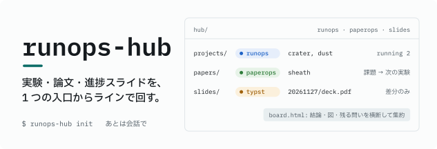
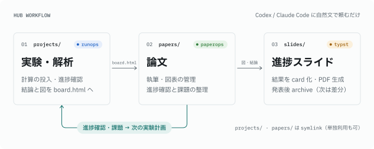

<picture>
  <source media="(prefers-color-scheme: dark)" srcset=".github/assets/hero-dark.svg">
  
</picture>

<p>
  <a href="pyproject.toml"></a>
  <a href="LICENSE"></a>
</p>

runops-hub は、[runops](https://github.com/Nkzono99/runops) や `paperops` を個別に直接操作せず、
1 つの directory から AI エージェントと一緒に研究全体を回すための入口です。人が打つコマンドは最初の
`runops-hub init` だけで、実験・論文・進捗スライドを工場のラインのようにつなげて進められます。

## 実験から論文・スライドまで

<picture>
  <source media="(prefers-color-scheme: dark)" srcset=".github/assets/pipeline-dark.svg">
  
</picture>

- **実験・解析（`projects/`）**: 複数 project の計算と解析を横断して把握し、分かった結論・図・残っている問いを `board.html` に集約します。
- **論文（`papers/`）**: 執筆や図表管理だけでなく、論文の構成と執筆状況から進捗・課題・不足している根拠を見つけて、次の実験計画へ戻します。
- **進捗スライド（`slides/`）**: `board.html` や論文の結果を 1 枚ずつの card にして Typst で PDF 化します。発表後は archive し、次回は差分だけで作れます。

## はじめる

```bash
uvx --from git+https://github.com/Nkzono99/runops-hub runops-hub init ~/work/hub
cd ~/work/hub
codex  # Claude Code なら claude
```

Linux 上で Git と [uv](https://docs.astral.sh/uv/getting-started/installation/) があれば動きます。
`init` の path を省略すると現在の directory に作ります。repository の clone や `runops` の事前
インストールは不要で、`AGENTS.md`（Claude Code 向けに `CLAUDE.md`）に手順が入り、必要な準備も
エージェントが行います。hub 本体の更新も「hub を最新版にして」と頼めば、規則や記録を残したまま
更新されます。

## 頼めること

| やりたいこと | 頼み方の例 |
|---|---|
| 既存 project をつなぐ | `/data/project_crater` の計算を、この hub から扱えるようにして |
| 全体の様子を見る | いま動いている計算の進捗と、完了後に未整理の run をまとめて教えて |
| 論文から次の一手を考える | `papers/sheath` の進捗と課題を確認して、次に必要な実験計画を立てて |
| 結果をまとめて比較する | 平坦面とクレーターの結果を比べて、図と `board.html` にまとめて |
| 進捗スライドを作る | クレーターの比較結果を次回の進捗スライドに追加して、PDF にして |
| 新しく計算を始める | 月面のダスト帯電を調べたい。既存 project で扱えるか見て、必要なら作って |
| 更新する | hub 本体と各 project の runops を最新にして |
| 完了した計算の解析と追加計算を任せる | `projects/crater` を hub auto の対象にして（以後は `./hub auto start` で定期実行） |

対象や目的が不足するときはエージェントが確認し、計算の投入は各 project の規則に従います。
裏で動く `./hub` コマンドの詳細は [コマンド・運用リファレンス](docs/reference.md) にあります。

## hub の中身

```text
hub/
├── AGENTS.md, CLAUDE.md   エージェントの入口。project 一覧と作業の規則
├── hub                    エージェントが使う ./hub
├── board.html             全 project の「分かっていること / 残る問い」（sync で更新）
├── projects/              各 runops project への symlink（例: projects/crater/）
├── papers/                各 paperops 論文への symlink（例: papers/sheath/）
├── slides/                進捗スライドの deck・card・archive
└── .hub/                  hub 本体のコード・Python path・状態
```

一覧・規則・`board.html`・`slides/` は hub に置き、run や解析・論文の実体は各 directory に
残します。`projects/` と `papers/` は symlink なので、それぞれを直接開いて単独で使うことも
そのままできます。hub 本体のコードは `.hub/runtime/` に保存するため、`uvx` のキャッシュを削除
しても `./hub` は動きます。

---

[コマンド・運用リファレンス](docs/reference.md) ·
[進捗スライド skill](skills/hub-slides/SKILL.md) ·
[開発・テスト](docs/development.md) ·
[Apache-2.0](LICENSE)
